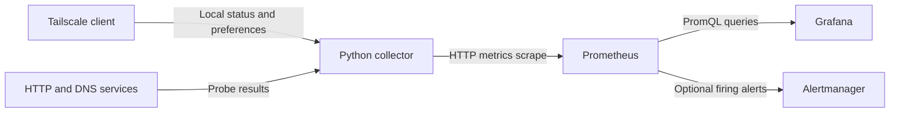

# Architecture

Each collector observes its own Tailscale daemon and configured dependencies.
Prometheus scrapes the collector; Grafana queries Prometheus rather than the
Tailscale admin API. This data flow keeps API credentials out of the collector:



## Collection cycle

The default scheduler polls every 30 seconds. It runs due dependency probes in
up to five concurrent threads and reads Tailscale state afterward. Each check
defaults to a 60-second period. The collector publishes a complete snapshot to
HTTP and atomically replaces `metrics.prom` in its state directory.

```sh
python3 src/tailscale_monitor.py --config examples/config.json --once
```

`--once` prints one snapshot and exits without starting the HTTP server.

## Boundaries

Node visibility follows the collector's tailnet identity and policy. Node
baselines compare complete tag sets. Advertised routes and SSH enabled flags
do not prove forwarding or login succeeds. Dependency probes originate on the
collector host, without Proxmox guest execution.

An unreachable collector makes its Prometheus `up` metric zero. A collector
whose HTTP process runs while collection stalls exposes an old cycle timestamp.
Optional alerts handle both conditions. If the monitoring host itself fails,
an independent alerting path is needed to send notifications.
